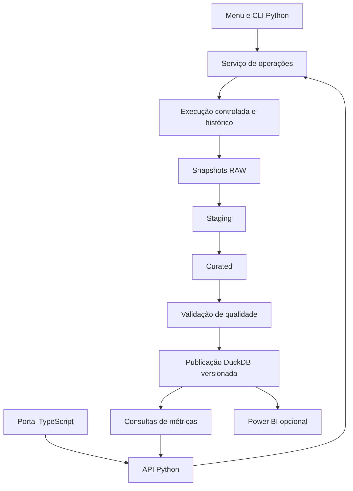

# Revisão de arquitetura e experiência de uso

Data: 09/09/2026. Escopo: código local, documentação, testes e artefatos PBIP. Este documento propõe a evolução; os comandos e componentes futuros abaixo ainda não estão implementados.

A recomendação é preservar RAW → STAGING → CURATED → DuckDB, criar uma única interface de operação e adotar um portal web como experiência principal para explorar e operar o projeto. O Power BI pode permanecer como consumidor opcional e referência de validação durante a migração.

O principal ganho vem de reduzir as decisões técnicas exigidas do usuário. A divisão interna em módulos continua sendo útil. Um único arquivo contendo geração, transformação, SQL, servidor e menu dificultaria a manutenção.

## 1. Experiência atual confirmada no código

Para reproduzir os dados e atualizar o relatório a partir de um clone, a pessoa precisa preparar Python e dependências, gerar um cenário, executar o ETL, construir o DuckDB, instalar Power BI Desktop e o driver DuckDB ODBC, configurar a fonte e carregar/atualizar o PBIP.

| Entrada atual | O que realmente executa | Limitação para o usuário |
|---|---|---|
| `generate_raw.py` | Geração das cinco fontes e manifesto inicial | Exige `--scenario-id`; não executa ETL nem analytics |
| `update_raw.py` | Snapshot filho completo de um cenário existente | Exige manifesto e data posterior; não executa ETL nem analytics |
| `run_etl.py` | Staging, curated, reconciliações e quality gate | Exige manifesto RAW; não constrói DuckDB |
| `run_pipeline.py` | Geração inicial seguida de ETL | Sempre gera outro cenário; não é o pipeline analítico completo |
| `4.analytics/build_analytics.py` | Oito views públicas e contexto da execução | Outra chamada e outro caminho que o usuário precisa localizar |
| Scripts individuais | Gerador ou transformação específica | Parte dos pontos de entrada ainda procura arquivos mais recentes em diretórios legados |

O modelo Power BI usa importação, com `dsn=Contract_analytics` nos arquivos TMDL. Atualizar o banco não atualiza automaticamente os dados importados no relatório. O banco padrão muda de diretório a cada `pipeline_run_id`, exigindo ajustar o DSN ou o junction local documentado.

Os dados gerados e o cache do Power BI estão ignorados pelo Git. Portanto, o clone não entrega o relatório já abastecido. Para simplesmente conhecer o projeto, exigir todo esse procedimento é uma barreira relevante.

A conexão ODBC também admite string de conexão sem DSN, conforme a [documentação Microsoft](https://learn.microsoft.com/en-us/power-query/connectors/odbc). Isso pode reduzir a configuração manual, mas não remove o driver nem o Power BI da experiência.

## 2. O que deve ser preservado

- Snapshots RAW imutáveis, com cenário, snapshot pai, parâmetros, contagens e SHA-256.
- ETL por manifesto explícito, sem combinar fontes arbitrárias de execuções diferentes.
- Isolamento de staging e curated por execução.
- Modelo dimensional, exceções de qualidade e reconciliação antes do consumo.
- Views SQL públicas como contrato de acesso e contexto temporal baseado em `as_of_date`.
- Testes existentes e CI configurado para Windows e Linux.

Isso já constitui uma base adequada para a proposta. Não é necessário trocar o motor analítico ou reescrever os geradores em TypeScript.

## 3. Oportunidades, evidências e implementação

| Prioridade | Evidência no projeto | Melhoria proposta | Implementação |
|---|---|---|---|
| P0 | `run_pipeline.py:73` termina no ETL | Um ponto de entrada que também conclua analytics | Fachada de operações compartilhada pelo menu, CLI e API; incluir geração, atualização, processamento e publicação como operações distintas |
| P0 | SQL financeiro e medidas DAX usam populações temporais diferentes | Contrato único de métricas antes da migração | Inventário das medidas, consultas SQL parametrizadas e testes com resultados esperados |
| P0 | `analytics_framework.py:84` cria `src_*` com `read_parquet` externo | Publicação analítica consistente e transportável | Manifesto analítico; novo artefato por build; opção de materializar fontes dentro do DuckDB de distribuição |
| P0 | `build_analytics.py:29` altera o banco indicado diretamente | Preservar a última publicação válida em caso de falha | Construir em destino novo, validar, fechar e somente então promover a publicação |
| P1 | `run_etl.py:47` contém a sequência fixa completa | Execução parcial com dependências verificadas | Registro de etapas, entradas/saídas explícitas, plano de dependências e manifesto por etapa |
| P1 | Não há catálogo operacional nem estado de execução central | Histórico, progresso, falhas e seleção simples de cenário | Registro local de jobs, catálogo de cenários/snapshots/publicações e bloqueio de execução concorrente |
| P1 | `update_raw.py:103` só gera contratos para empresas novas | Atualização de cenário com semântica explícita | Separar chegada de fornecedores, contratação, eventos contratuais, pagamentos e evolução de risco |
| P1 | Anos fixos no gerador, staging, curated e reconciliações | Horizonte financeiro configurável | Centralizar calendário da simulação e versionar o contrato das fontes; evoluir as camadas em conjunto |
| P1 | `requirements*.txt` usa apenas limites inferiores; `pyproject.toml` não define pacote | Instalação reproduzível | Pacote Python, dependências de execução/desenvolvimento separadas, resolução travada e versões Python verificadas em CI |
| P1 | README principal chama curated de futura; README do dashboard omite argumentos obrigatórios | Onboarding coerente com a implementação | Um quickstart validado em clone limpo; comandos avançados em documentação própria |
| P2 | `sys.path.insert`, caminhos numéricos e utilitários duplicados | Organização importável e manutenção mais simples | Migração gradual para `src/contract_platform`, com os scripts antigos como adaptadores temporários |
| P2 | IDs gerados com resolução de segundos; seed global | Robustez e reprodução das operações | IDs com sufixo único, seed efetiva persistida e gerador aleatório por execução |

P0 precede a substituição do dashboard; P1 integra o MVP operacional; P2 pode avançar em refatorações pequenas. Não há evidência de volume que justifique impor processamento incremental de ETL, um scheduler distribuído ou outra infraestrutura agora.

### Divergência de métricas que precisa ser resolvida

`4.analytics/sql/08_vw_supplier_financials.sql:23` seleciona contratos cuja vigência intercepta o ano financeiro. A medida `Valor Anualizado de Contratos Ativos`, em `analytics_run_context.tmdl:692`, exige status ativo e vigência contendo a data do snapshot. A dependência DAX usa ainda o faturamento mais recente do fornecedor.

Exemplo: um contrato que terminou em março de 2026 pode participar da exposição anual SQL de 2026, mas ficar fora da carteira ativa DAX em julho. São perguntas distintas. O dicionário atual descreve a segunda, enquanto o KPI SQL financeiro apenas seleciona a view com a primeira.

Proposta: manter a exposição histórica anual com nome explícito e criar a métrica de dependência da carteira ativa alinhada ao contrato documentado. Não alterar silenciosamente o significado de uma coluna já consumida.

Há 65 declarações de medidas nos TMDL do modelo, incluindo medidas auxiliares e de apresentação. A migração precisa inventariá-las junto com relacionamentos, filtros e `dashboard_measures.dax`; não basta traduzir oito views em oito endpoints.

Também devem ser preservadas as diferenças entre posição acumulada, fluxo no ano, saldo de fechamento e comparação móvel. Filtros têm escopos diferentes: por exemplo, a dependência do fornecedor pode considerar sua carteira completa, enquanto a ponderação por categoria considera os contratos daquela categoria.

### Limites da atualização atual

`update_raw.py` preserva os arquivos do pai, mas modifica registros existentes na cópia e grava todas as fontes novamente. Portanto, atualização do cenário não equivale a append físico nem a ETL incremental.

O código atual também:

- Cria contratos novos apenas para fornecedores recém-gerados; a probabilidade é aplicada ao lote nessa função.
- Altera contratos ativos já vencidos para `Vencido` antes de gerar pagamentos, sem implementar uma simulação de todos os eventos entre as duas datas.
- Emite pagamentos na nova data de referência; o parâmetro `data_anterior` não participa da função de pagamentos.
- Reativa avaliações expiradas copiando seus atributos; não constitui um modelo completo de evolução dos riscos existentes.
- Calcula a quantidade de novas matrizes a partir do total de linhas de empresas e acrescenta filiais, o que pode divergir da expectativa criada pelo nome “probabilidade de novos fornecedores”.

Esses comportamentos são observações do código. Seu impacto numérico em diferentes cenários exige testes específicos; não se presume que toda atualização falhe.

O MVP pode manter o reprocessamento completo de snapshots. Antes de oferecer evolução temporal ampla, deve definir eventos válidos entre datas, critérios de elegibilidade, regras de saldo e disponibilidade de dados financeiros. A geração financeira ainda está fixada em 2022–2026; avançar a data do snapshot não cria automaticamente um novo exercício financeiro.

## 4. Arquitetura proposta



Recomendação de stack: Python para os serviços existentes e API FastAPI; React, TypeScript, HTML/CSS e Vite para o portal. React é uma escolha de organização para filtros, tabelas, navegação e estados de execução, não uma exigência do DuckDB. Bibliotecas de gráficos devem ser escolhidas por acessibilidade, interações e tamanho do bundle em uma pequena prova de conceito.

O backend usa a biblioteca Python DuckDB diretamente, sem ODBC. O TypeScript organiza a interface e consome respostas da API; os cálculos financeiros permanecem no SQL/Python. Dinheiro deve ter representação decimal controlada ou valores em centavos no contrato de resposta; arredondamento visual não deve alterar a reconciliação.

O custo da escolha é assumir manutenção de interface, filtros, tabelas, interações entre gráficos, exportações e acessibilidade que hoje dependem da ferramenta de BI. Para um projeto cujo foco seja exclusivamente modelagem Power BI, simplificar o launcher e a conexão seria uma intervenção menor. Para o objetivo expresso de um portal explorável e operacional, a aplicação web é a recomendação, com migração gradual e critérios de equivalência.

Uma aplicação estática isolada não executa os scripts Python atuais. Para oferecer os botões operacionais no navegador, é necessário um serviço local ou hospedado. DuckDB-Wasm permite consultar dados no navegador, mas não substitui esse serviço de execução do pipeline Python. É uma alternativa para uma demonstração somente de consulta, após empacotar dados e consultas compatíveis. [DuckDB-Wasm](https://duckdb.org/docs/current/clients/wasm/overview).

### Estrutura de código sugerida

```text
src/contract_platform/
  cli.py                   # Menu e subcomandos
  application/             # Operações compartilhadas
  pipeline/                # Etapas, dependências e execução
  generators/              # Geradores e atualização de cenário
  staging/
  curated/
  analytics/               # Publicação e consultas SQL
  api/                     # Leitura analítica e controle de jobs
  runtime/                 # Catálogo, estado e locks
portal/                    # React, TypeScript e CSS
configs/                   # Presets de demonstração e parâmetros
tests/
docs/
```

As funções já existentes são o ponto de partida. Evitar criar uma segunda implementação do pipeline para o portal. Um adaptador temporário pode chamar os scripts em processo separado com argumentos fixos; a solução final usa funções importáveis e um único contrato de operação.

## 5. Menu mestre e semântica das ações

| Opção no menu | Operação proposta | Efeito no dashboard |
|---|---|---|
| Criar novo cenário RAW | Geração inicial com cenário, seed e data | Ainda não troca a publicação ativa |
| Atualizar somente o RAW | Snapshot filho de cenário selecionado | Mostra que existe uma versão ainda não processada |
| Executar etapas específicas | Etapas selecionadas e dependências necessárias | Só publica se todos os requisitos analíticos forem satisfeitos |
| Processar dataset existente | Staging → curated → qualidade → analytics | Publica o resultado aprovado sem gerar ou atualizar RAW |
| Atualizar dados e dashboard | Snapshot filho → ETL completo → analytics | Troca a publicação após sucesso |
| Criar cenário e preparar dashboard | Geração inicial → ETL completo → analytics | Fluxo recomendado para a primeira execução |
| Abrir portal / consultar execuções | Navegação e estado | Não modifica o dataset |

Propostas de comandos, após empacotamento: `contract-platform menu`, `contract-platform serve`, `contract-platform pipeline run --snapshot <id>`, `contract-platform data update --snapshot <id> --as-of <data> --process` e `contract-platform doctor`. Os nomes finais podem ser ajustados, mas a semântica deve permanecer única.

O menu resolve caminhos por IDs do catálogo. Na seleção, mostra cenário, data, seed, número de registros e última publicação aprovada. “Mais recente” só pode ser uma conveniência dentro de um cenário explicitamente selecionado; nunca deve combinar arquivos de cenários diferentes.

Criar outro dataset exige reconstruir os derivados desse dataset. Não exige hard reset: cria-se outro `scenario_id`, mantendo o anterior para comparação e retorno. Exclusão de cenários antigos é uma operação separada de manutenção, verificando dependências e publicações ainda utilizadas.

Na execução parcial, o usuário escolhe o objetivo e visualiza o plano. Por exemplo, reconstruir analytics reaproveita curated aprovado; reconstruir contratos e gastos requer as fontes e dimensões correspondentes. Etapas reutilizadas precisam ter origem, versão de código/configuração e hashes compatíveis. Não se aceita um `etl_manifest.json` de sucesso completo para um conjunto incompleto.

## 6. Portal: páginas por domínio, com rolagem dentro de cada página

Recomendo uma aplicação com navegação lateral e rotas próprias. O projeto já tem quatro páginas PBIP: Visão de Categoria, Contratos, Spending e Fornecedores. Elas podem orientar a migração.

| Área proposta | Conteúdo |
|---|---|
| Visão geral / categorias | Carteira, evolução e comparações por categoria |
| Contratos | Consumo, saldo, vencimentos, renovações e detalhe contratual |
| Spending | Série temporal, concentração e pagamentos |
| Fornecedores | Pesquisa por CNPJ, riscos, dependência e histórico financeiro |
| Qualidade | Reconciliações e exceções com origem identificada |
| Dados e execuções | Mesmo catálogo de ações do terminal, parâmetros, progresso e histórico |

Uma rolagem contínua para todos os domínios mistura contextos de filtro, alonga a navegação e incentiva carregar visuais desnecessários. Rotas permitem links para detalhes e retorno ao contexto anterior. Cada página pode rolar quando necessário e se adaptar à largura disponível, sem reproduzir rigidamente as telas PBIP de 1920 × 1080.

Mostrar sempre cenário, data do snapshot, publicação utilizada e estado de atualização. Preservar filtros comuns na navegação e limitar os específicos ao domínio. Usar URL para filtros compartilháveis. Tabelas devem ter paginação/virtualização e detalhamento; cards devem indicar unidade e tratamento de ausência de dados.

O menu operacional fica em “Dados e execuções”, com atalhos simples nas telas analíticas. Ao atualizar, a pessoa acompanha etapas reais e contagens, sem percentuais de progresso inventados. Se falhar, o dashboard continua mostrando a última publicação aprovada e informa a falha separadamente.

As views atuais de exceções consolidam exceções curated. Para uma tela de qualidade do pipeline inteiro, será necessário incorporar também as exceções e contagens da staging, identificando a camada. A reconciliação staging → curated não demonstra, sozinha, qualidade de todas as linhas RAW.

## 7. Execução, publicação e API

O MVP pode usar um registro SQLite local para jobs e catálogo, separado do DuckDB analítico, e um executor Python com um único job de escrita por vez. Terminal e API compartilham a mesma regra de exclusão mútua, inclusive entre processos. Usar processo de trabalho separado evita que geração e ETL bloqueiem as respostas do portal e isola o estado aleatório atual. A própria documentação FastAPI distingue tarefas de fundo simples de processamento pesado. [FastAPI](https://fastapi.tiangolo.com/tutorial/background-tasks/).

Registrar `queued`, `running`, `succeeded`, `failed` e `interrupted`, etapa atual, início/fim, parâmetros, entradas, saídas e erro. Uma queda do servidor deve deixar a execução identificável como interrompida. O botão de reenviar não pode criar duplicatas por acidente: requisições operacionais recebem chave de idempotência. Não confundir isso com proibir reprocessamento intencional.

Contrato inicial sugerido:

- `GET /api/scenarios`, `/api/snapshots`, `/api/publications`: seleção de dados e contexto.
- `POST /api/jobs`: operação permitida e parâmetros validados; retorna ID e HTTP 202.
- `GET /api/jobs/{id}`: progresso e diagnóstico; polling é suficiente no MVP.
- `GET /api/overview`, `/api/contracts`, `/api/spending`, `/api/suppliers`, `/api/quality`: consultas com filtros, paginação e publicação explícita.

Cada carregamento de página deve fixar um `publication_id`: a troca da publicação ativa não pode fazer um card consultar o lote antigo e outro o novo. O cache inclui publicação e filtros. Usar SQL parametrizado e lista permitida para ordenação; não expor execução arbitrária de SQL ou comandos de shell.

Para uso local, servir frontend e API na mesma origem, em loopback, com validação de origem/token para operações de escrita e IDs que não aceitem escapar do diretório de dados. Uma instalação acessível pela rede exige autenticação e autorização operacional. Esses controles fazem parte da implementação dos botões, não devem virar uma configuração complexa para o visitante da demonstração.

### Publicação sem interromper a consulta

1. Produzir um novo conjunto de artefatos, identificado por execução/publicação.
2. Validar qualidade, presença e esquema das views, consultas de métricas e reconciliações.
3. Fechar o escritor e registrar o manifesto analítico completo, com versões e hashes dos artefatos.
4. Trocar a referência da publicação ativa em uma transação do catálogo.
5. Deixar leitores existentes terminarem na publicação anterior; novas consultas passam a usar a nova.

No modo embutido em arquivo, DuckDB distingue um processo com leitura/escrita de vários processos apenas leitores. Construir uma publicação diferente enquanto a anterior é lida evita depender de escrita concorrente no mesmo arquivo. [Concorrência DuckDB](https://duckdb.org/docs/current/connect/concurrency).

Hoje o arquivo `.duckdb` contém views sobre caminhos locais de Parquet. Para operação local, esse arranjo pode ser preservado com manifesto e retenção conjunta. Para download de uma base independente, recomendo materializar as fontes internas no DuckDB de distribuição e conservar as views públicas. O custo é duplicar parte do armazenamento; o benefício é não depender dos caminhos da máquina de origem. Um teste de portabilidade deve consultar todas as views após mover a cópia e tornar os Parquets originais indisponíveis no ambiente de teste.

## 8. Distribuição e onboarding

Existem três experiências diferentes que convém atender explicitamente:

| Público | Caminho proposto | Dependências do usuário |
|---|---|---|
| Visitante do portfólio | Abrir demonstração publicada com cenário pronto | Navegador |
| Pessoa que quer gerar/atualizar dados | Instalar pacote/release e abrir portal local | Python compatível e dependências empacotadas/instaladas |
| Pessoa que quer desenvolver | Clonar código e instalar ambientes de desenvolvimento | Python e Node para trabalhar no frontend |

O build de produção do frontend pode ser distribuído junto ao pacote Python, evitando exigir Node de quem só usa o portal. O Vite produz um bundle apropriado para distribuição; a etapa de build pertence ao desenvolvimento/CI. [Vite](https://vite.dev/guide/build).

Um clone puro ainda precisa preparar o ambiente. Para realmente melhorar isso, entregar um launcher que verifica Python, cria ambiente, instala dependências travadas, inicia o serviço e abre o navegador, além de uma release com frontend já compilado. O primeiro acesso oferece um cenário de demonstração reproduzível, com seed e data explícitas; iniciar o portal novamente não regenera dados.

Uma demonstração pública de consulta é a prioridade para portfólio. Publicar operações de geração para visitantes acrescenta necessidade de isolamento por sessão, limites de recursos e armazenamento persistente; isso deve ser uma evolução própria. O menu completo funciona inicialmente no portal local.

Power BI permanece útil para demonstrar modelagem e DAX. Pode ficar em uma área opcional do repositório durante a transição, com instruções corrigidas e atualização explícita. A decisão de mantê-lo permanentemente depende de quanto o portfólio quer destacar essa competência.

## 9. Sequência de entrega e critérios de aceitação

| Etapa | Entrega | Evidência de conclusão |
|---|---|---|
| 1. Contratos e baseline | Inventário SQL/DAX, semântica de atualização e quickstart corrigido | Conjunto pequeno de cenários conhecidos com métricas esperadas, inclusive a diferença entre carteira ativa e exposição anual |
| 2. Operação unificada | Fachada, menu, subcomandos, catálogo e integração analytics | Criar, atualizar e reprocessar completam o caminho até DuckDB; reprocessar não altera RAW; falha preserva publicação anterior |
| 3. API e portal inicial | Visão de categoria, contexto/filtros e Dados e execuções | Usuário conclui o fluxo pelo navegador; nenhuma conexão ODBC; concorrência e recuperação verificadas |
| 4. Migração dos domínios | Contratos, Spending, Fornecedores e Qualidade | Valores conciliados por filtros; ausência de duplicação de fatos; estados vazios e nulos corretos; navegação acessível |
| 5. Distribuição | Pacote/release, launcher e demonstração de consulta | Teste em ambiente limpo; usuário final não precisa instalar Node ou Power BI; artefato portátil validado |

Os testes de métricas devem cobrir pagamentos e eventos nas bordas do ano, janelas móveis, contratos encerrados, ausência de receita, matriz/filial, zero denominador e filtros de categoria. A implementação SQL deve ser verificada contra pequenos casos calculados independentemente, e depois comparada com o PBIP. Divergências não devem ser resolvidas copiando cegamente um resultado DAX.

A operação deve ser testada com clique duplicado, CLI e portal concorrentes, falha em etapa intermediária, falha de analytics e reinício do serviço. Para execução parcial, testar rejeição de entradas incompatíveis e rastreabilidade das etapas reutilizadas.

As estimativas de prazo devem ser feitas após a etapa 1: o maior fator de incerteza é a migração das regras e interações do modelo Power BI, além da decisão sobre quanto ampliar a simulação de atualização.

## 10. Verificação desta revisão

Foram inspecionados os cinco pontos de entrada, frameworks de snapshots e analytics, transformações e reconciliações selecionadas, geradores, SQL de views/KPIs, testes, CI, consultas M, medidas e relacionamentos TMDL e definição das quatro páginas PBIP. Não foi feita inspeção visual no Power BI nem medição de desempenho em grande volume.

- `python -m ruff check .`: aprovado no ambiente local.
- `python -m pytest -q`: 40 testes aprovados em 192,43 segundos. A suíte existente verifica geração, transformações, snapshots, reconciliações e construção analítica; não demonstra equivalência numérica entre DAX e SQL.
- O ambiente local existente usa Python 3.14.6, enquanto a matriz CI declara 3.12. A validação local não substitui a verificação da instalação documentada em ambiente limpo.

Nenhum código de execução, dataset ou relatório Power BI foi alterado nesta revisão.
